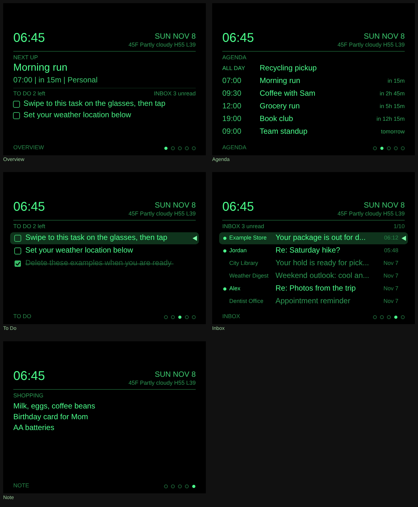

# MIRA Apps

Community apps for MIRA smart glasses. Each app is one HTML file you install
from the MIRA iPhone app. No computer or coding needed to use them.

Community projects. These are not official MIRA software.

## Apps

| App | What it does | Download |
|-----|--------------|----------|
| [Glance Dashboard](GlanceDashboard/) | Heads-up clock, weather, calendar, to-do list, inbox and a pinned note. Swipe through panels on the glasses and tap to check off tasks. Optional live Google Calendar and Gmail. | [Latest release](https://github.com/jdgriffin7/mira-apps/releases/tag/v1.2) |

## Installing an app

1. Open the app's latest release from the table above and download its `.html` file.
2. In the MIRA iPhone app, go to **Apps > Build a Mira App > Create**. Upload the file,
   then tap **Check code > Add > Install > Open**.

To update an app you already have, long-press its card, tap **Edit App**, upload the new
file, then tap **Save > Update > Open**. Keep the app's name the same so MIRA replaces it.

Each app's folder has a README with its controls, settings and build steps.

## Building from source

Every app builds the same way with the
[MIRA SDK](https://github.com/big-halo/mira-sdk): copy the app's folder to the root of the
SDK, next to `Shared/` and `CompanionExample/`, then follow the build steps in that app's
README. You need Rust, Python 3 and Node.js.

Releases are named after the app, for example `glance-dashboard-v1.3`.
Glance Dashboard's first releases are tagged `v1.0` to `v1.2`.

## License

The files in this repository are released under the MIT License (see [LICENSE](LICENSE)).
The MIRA SDK files the apps build with are not part of this repository and remain under
MIRA's own terms.
